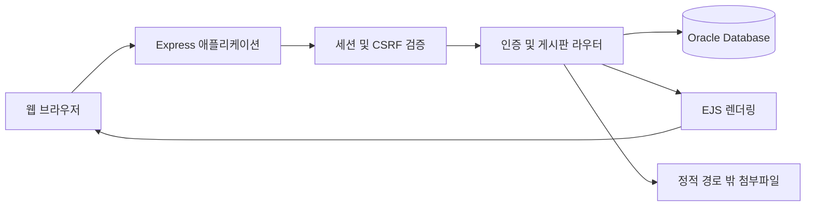

# BBS — Bulletin Board System

**Personal Project**

BBS는 Node.js, Express, EJS, Oracle Database를 사용하는 게시판 웹 애플리케이션이다. 회원 인증을 기반으로 게시글과 댓글, 추천·비추천, 검색, 첨부파일을 제공하며, 서버 측 인가와 CSRF 방어 등 웹 애플리케이션 보안 요소를 적용했다.

## 01. 프로젝트 개요

브라우저에서 게시판 기능을 이용하고 Express 애플리케이션이 세션, 요청 검증, Oracle 쿼리와 EJS 렌더링을 처리한다. 제공받은 기본 게시판 구조와 구현 방법을 바탕으로 기능을 확장한 개인 프로젝트다.

## 02. 기술 스택

| 영역 | 기술 |
| --- | --- |
| Backend | Node.js, Express 4, JavaScript |
| Frontend | EJS, HTML, CSS, Bootstrap, Bootstrap Icons |
| Database | Oracle Database, node-oracledb |
| Authentication / Session | express-session, Node.js crypto |
| Security | scrypt, CSRF 토큰, SQL 바인딩, Multer |
| Testing | Node.js test runner, Supertest |

일부 화면은 Bootstrap과 Bootstrap Icons를 CDN에서 불러온다.

## 03. 시스템 아키텍처



## 04. 주요 구현 기능

- **회원 및 인증:** 회원가입, 로그인·로그아웃, 아이디 찾기, 회원정보 수정과 세션 기반 인증을 제공한다. 비밀번호 변경에는 현재 비밀번호가 필요하다.
- **게시글 관리:** 작성·목록·상세·수정·삭제와 조회수를 제공하며 수정·삭제 시 서버가 작성자를 확인한다.
- **댓글과 반응:** 댓글과 대댓글을 작성하고 본인 댓글을 수정·삭제할 수 있다. 게시글과 댓글에 추천·비추천을 선택한다.
- **검색과 내 활동:** 검색어와 검색 조건을 적용하고 최신순·조회순·추천순 정렬과 페이지네이션을 제공한다. 내 활동에서 자신의 게시글과 댓글을 확인한다.
- **첨부파일:** 게시글에 TXT(UTF-8), PDF, PNG, JPG 파일을 최대 10 MiB까지 첨부하고 게시글을 통해 다운로드한다.

비밀번호 재설정은 안전한 소유 확인 수단이 마련될 때까지 비활성화되어 있다.

## 05. 데이터베이스 설계

[스키마 초안](db/schema.sql)은 다음 객체를 정의한다.

| 객체 | 역할 및 제약 |
| --- | --- |
| `LOGIN` | 사용자 정보, 기본 키 `ID` |
| `BBS` | 게시글 및 첨부파일 정보, 기본 키 `NO` |
| `BBSW` | 댓글·대댓글, 기본 키 `NO`, `BBS_NO`의 게시글 외래 키 |
| `BBS_REACTION` | 게시글 반응, 게시글 번호와 사용자 ID의 복합 기본 키 |
| `BBSW_REACTION` | 댓글 반응, 댓글 번호와 사용자 ID의 복합 기본 키, 댓글 외래 키 및 반응 값 검사 |
| `BBS_SEQ`, `BBSW_SEQ` | 게시글 및 댓글 번호 생성 |

`BBSW.PARENT_NO`로 대댓글의 부모를 표현한다. 초안에 게시글 반응·사용자·부모 댓글에 대한 외래 키는 정의하지 않았다. 실제 테스트 스키마에서 객체와 주요 기능을 확인했지만 초안과 실제 DDL의 완전한 일치는 비교하지 않았다.

## 06. 웹 보안 설계

- **비밀번호:** 신규·변경 비밀번호는 scrypt로 해시하고 기존 SHA-512 해시 검증을 지원한다.
- **인증 및 인가:** 로그인 시 세션을 재생성하며 게시글·댓글의 변경에 서버 측 작성자 조건을 적용한다. 쿠키에 HttpOnly와 SameSite를 설정하고 production에서 Secure를 사용한다.
- **CSRF:** 상태 변경을 POST로 처리하고 세션 기반 CSRF 토큰을 확인한다.
- **SQL:** 주요 사용자 입력을 바인딩 변수로 전달한다. 연결되지 않은 참고 라우터는 보안 설계의 대상이 아니므로 사용하지 않는다.
- **파일:** 확장자·일부 파일 시그니처·크기를 검사하고 정적 공개 경로 밖에 저장한다. 다운로드에는 `nosniff`를 적용한다. 파일 검사는 완전한 콘텐츠 검증이나 악성 파일 검사가 아니다.
- **비밀정보:** DB 연결정보와 세션 비밀값은 환경변수로 공급한다.

적용한 보안 기능은 모든 공격에 대한 완전한 방어를 의미하지 않는다. 상세 범위는 [SECURITY_REVIEW.md](SECURITY_REVIEW.md)를 참고한다.

## 07. 실행 방법

1. Node.js 24, npm과 격리된 Oracle 테스트 스키마를 준비한다. [스키마 초안](db/schema.sql)을 검토한 후 빈 테스트 스키마에 적용한다. 기존 데이터베이스에는 영향을 먼저 확인한다.
2. `.env.example`을 `.env`로 복사하고 DB 계정·비밀번호·연결 문자열과 충분히 긴 임의의 `SESSION_SECRET`을 직접 설정한다. 환경 파일은 공개하지 않는다.
3. `npm ci --ignore-scripts`로 의존성을 설치한다. 애플리케이션은 `.env`를 자동으로 읽지 않는다.
4. Node.js 24에서 다음 명령을 실행하고 `http://127.0.0.1:3000/bbs`에 접속한다.

```sh
node --env-file=.env -e "require('http').createServer(require('./app')).listen(process.env.PORT || 3000, '127.0.0.1')"
```

`npm start`는 모든 네트워크 인터페이스에 바인딩하므로 로컬 전용 테스트에는 위 명령을 사용한다. 운영 시 HTTPS·프록시, 운영용 세션 저장소와 요청 제한 등이 별도로 필요하다.

## 08. 테스트 및 검증

- **실제 Oracle XE 21c:** 격리된 테스트 스키마의 테이블 5개와 시퀀스 2개, 회원가입·로그인, 게시글 CRUD, 댓글·대댓글, 추천·비추천, 검색·정렬·내 활동, TXT 첨부, 인증·인가 및 CSRF 차단을 확인했다.
- **모의 Oracle:** `npm test`의 20개 테스트가 통과했다. 실제 Oracle 검증과 별개의 모의 DB·HTTP 테스트다.
- **의존성:** `npm audit`에서 취약점 0건을 확인했다. 검사 당시 알려진 취약점에 대한 결과다.
- **브라우저:** 일부 데스크톱·좁은 화면과 합성 데이터로 인증 후 화면의 렌더링을 확인했다. 전체 브라우저 조작과 모바일 화면, 여러 페이지에 걸친 정렬 경계, 동시성 및 모든 첨부 형식은 미검증이다.

## 09. 향후 개선 사항

- 안전한 비밀번호 재설정 및 운영용 세션 저장소·요청 제한
- 반응형 UI와 전체 브라우저 사용자 흐름 추가 검증
- 파일 형식별 검증과 여러 페이지에 걸친 검색·정렬 테스트 보강
